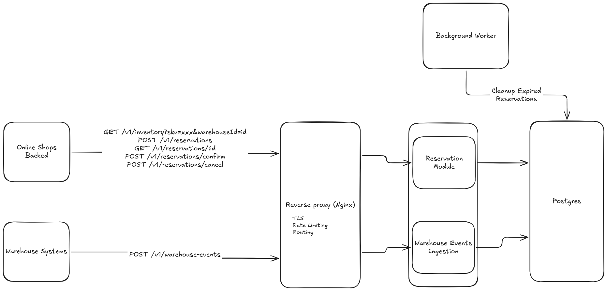

# Inventory Management System

A backend system for managing inventory across multiple warehouses and reserving stock for online orders.

## Scope

- View stock for a specific product stock at specific workhouse
- Reserve stocks
- View reservations statuses
- Confirm or cancel the reservation
- Prevent overselling during concurrent requests
- Record physical stock changes at warehouses

## Architecture

## API Endpoints

| Method | Endpoint                                | Description                              |
| ------ | --------------------------------------- | ---------------------------------------- |
| GET    | `/v1/inventory?sku=xxx&warehouseId=xxx` | Get stock for a product at a warehouse.  |
| POST   | `/v1/reservations`                      | Create a stock reservation.              |
| GET    | `/v1/reservations/:id`                  | Get reservation details.                 |
| POST   | `/v1/reservations/:id/confirm`          | Confirm a reservation.                   |
| POST   | `/v1/reservations/:id/cancel`           | Cancel a reservation and release stock.  |
| POST   | `/v1/warehouse-events`                  | Process Warehouse Physical Stock Changes |

## Running Locally
